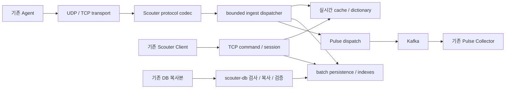

# Scouter Server Go 포팅 설계

초기 설계: 2026-10-13. 현재 구현 설명은 2026-11-07 소스 대조 기준이다. 호환성 원본 revision은 [baseline.json](compatibility/baseline.json), 기능별 상태는 [implementation-plan.md](implementation-plan.md)를 따른다.

## 요구사항과 범위

단일 Go 애플리케이션으로 기존 Scouter Server를 대체한다. 기존 Java/Host Agent와 Scouter Client를 수정하지 않고 연결하며, 조회 의미와 기존 데이터 이관을 보존한다. Pulse plugin은 Go 서버의 내장 기능으로 통합한다(3단계에서 구현). 다른 Pulse 서비스의 UUID 생성 책임이나 Kafka 수신 계약을 바꾸지 않는다.

목표는 자원 사용을 줄이면서 완료 transaction 기준 처리량을 높이는 것이다. 운영 규모·목표 처리량·호스트 사양은 환경마다 다르므로 이 문서에 고정하지 않는다. 호스트는 다른 서비스와 공유될 수 있으므로 실제 사용 한도는 별도로 정한다. 언어 변경만으로 성능 목표 달성을 가정하지 않는다.

## 접근 방식

| 선택지 | 이점 | 한계 | 결정 |
| --- | --- | --- | --- |
| Go 참고 서버를 그대로 기반으로 사용 | 많은 코드와 운영 예제가 이미 있음 | 기존 파일 형식 차이, 수신·조회 기능 누락, Java 상호운용 증거 부족 | 전체 복제하지 않음 |
| Java/Scala를 파일 단위로 직역 | 원본을 추적하기 쉬움 | thread/lock/단건 I/O 구조까지 옮길 가능성, Go 소유권 불명확 | wire/저장 의미만 정본으로 사용 |
| 계약을 고정하고 Go 경계별로 구현 | 호환성과 성능 변경을 각각 검증 가능 | fixture와 단계별 통합이 필요 | 채택 |

참고 구현의 유용한 설계와 보류 이유는 [reference-evaluation.md](reference-evaluation.md)에 기록한다. 채택 후보도 profile과 계약 테스트를 통과해야 실제 최적화로 반영한다.

## 컴포넌트와 데이터 흐름

아래 구조의 Go 내부 경로는 구현되어 있다(`internal/protocol`, `transport`, `ingest`, `storage`, `service`, `pulse`와 `server`의 runtime 연결, 원본 형식 DB 읽기·쓰기, `cmd/scouter-db`의 검사·검증된 복사 이관). Kafka 이후 Pulse Collector 실연동과 운영 DB 이관은 별도 검증 gate다. 이관은 형식 변환이 아닌 바이트 복사다([migration](compatibility/migration.md)).

- **protocol**: byte slice와 객체 단위 io.Reader 기반 순수 codec. 타입/길이/중첩 상한, signed 정수, UTF-8, 선택 필드를 처리한다. 입력 버퍼를 다른 goroutine과 공유하지 않는 명확한 소유권을 갖는다.
- **transport**: UDP 단일·묶음·분할 및 TCP 연결별 framing을 처리한다. 불완전 stream, deadline, 재조립 만료/상한, 종료를 담당한다. 외부 frame의 데이터 길이를 믿고 메모리를 무제한 할당하지 않는다.
- **ingest/core**: packet별 처리·dictionary·object·counter·XLog/profile 의미를 소유한다. worker 수와 queue 한도를 명시하고 포화 결과를 계수한다. 순서에 의존하는 데이터는 동일 partition/worker에서 처리한다.
- **storage**: 날짜별 데이터와 time/txid/gxid 인덱스의 일관성, write 완료/flush/fsync, 재시작 복구, retention을 소유한다. index·record 조회에 `ReadAt` 기반 positional read를 사용하고 close/purge 동안 사용 중인 파일의 수명을 보호한다.
- **service**: 명령 registry, 실제 socket peer에 기반한 인증, session/권한, 명령별 request/response와 cursor를 소유한다. body가 없는 명령, Value/Blob 응답을 Pack 응답과 구분한다.
- **pulse**: XLog/profile 이벤트를 별도 bounded queue로 받아 필터·dictionary 보강·JSON/Step encoding·Kafka 전송을 담당한다. publish 실패가 core 수집을 동기적으로 막지 않도록 한다.

## 공유 서버 자원 모델

process CPU 예산(`GOMAXPROCS` 및 OS quota), runtime 메모리 목표(`GOMEMLIMIT`), queue/cache 한도, 디스크 쓰기 대역폭을 각각 관리한다. `GOMEMLIMIT`는 runtime soft limit이며 프로세스 RSS hard cap이 아니다. 한도가 없으면 호스트 전체 자원을 써도 된다고 해석하지 않는다.

queue 수락, 저장 완료, 동기화 완료, Kafka producer queue 수락, broker 응답은 서로 다른 사건이다. Pulse의 `sent`는 producer queue 수락이며 broker 영속 증거가 아니다. API와 지표에서 구분한다. UDP는 송신자에게 backpressure를 전달할 수 없으므로 kernel drop과 application drop을 별도 관찰한다. silent drop을 성능 개선으로 계산하지 않는다.

lifecycle과 제한은 [runtime 계약](compatibility/runtime.md)에 기록한다. 2026-10-21~25에 연결 수(Agent·Client 분리), Client 응답·Agent relay 메모리, HTTP 동시 요청, Pulse queue byte, engine cache, visitor 메모리에 전역 상한과 계수를 두고, 저장 I/O를 수집 lock 밖으로 옮기고, 종료 상한을 더했다([개선 대상](improvement-candidates-2026-10-21.md)). 환경별 값을 정하는 방법은 [sizing](operations/sizing.md)에 있다. 운영 자원 예산 자체는 환경마다 정하며, 실제 payload mix와 저장·조회 부하로 작은 CPU/메모리 예산부터 검증한다.

## 저장 데이터 호환과 전환

기존 DB의 사용자 정의 파일/인덱스 및 압축 block은 별도 계약이다. Go 참고 구현의 `xlog.data`/zstd 형식이 원본의 `xlog.service`/GZipStore와 동일하다고 가정하지 않는다.

1. 원본을 멈춰 생성한 synthetic DB 및 운영 DB의 비식별 복사본을 읽기 전용으로 검증한다.
2. Java reader 결과를 기준으로 Go legacy reader를 검증한다. 날짜, 5-byte 위치, text namespace, profile chunk와 time/txid/gxid 인덱스를 포함한다.
3. Go writer는 Java 파일·index 형식을 유지한다. 양방향 reader oracle, 재시작 복구와 조회 테스트로 호환성을 검증한다([저장 계약](compatibility/storage-contract.md)).
4. `scouter-db migrate`는 다른 directory로 복사하며 입력을 수정하지 않는다. manifest·checksum·복사 후 검증을 제공하고 증분 이관은 `--precopy`/`--finish`로 수행한다. 운영 복사본에서는 실제 Client 조회 결과와 이관·rollback을 추가 검증한다.
5. Java와 Go의 동일 DB 동시 쓰기를 금지한다. shadow replay → 일부 Agent 전환 → rollback 검증 → 전체 전환 순서로 진행한다.

## 외부 확장과 전체 호환

원본의 JVM plugin JAR, dynamic handler, alert script, LDAP/HTTP/webapp, DB agent 명령은 wire codec과 별개다. Go 바이너리가 JVM bytecode를 직접 실행한다고 주장하지 않는다. 사용 중인 확장은 목록화하여 동등한 Go 기능/검증된 adapter/명시적 호환 제약으로 다룬다. Pulse plugin은 프로젝트 범위에 따라 내장 구현한다. LDAP·HTTP servlet·Telegraf·webapp REST와 관리 명령은 Go 기능으로 구현했고, JVM plugin JAR·`.alert`/`.plug` 스크립트 실행·확장 handler chain과 webapp의 extweb·swagger·WebSocket은 제외 확정(명시적 미지원)이다. 단계별 상태는 [implementation-plan.md](implementation-plan.md)를 따른다.

229개 handler inventory는 구현 누락 추적의 시작점이며 전체 동작의 증거는 아니다. handler가 등록되어도 응답/권한/empty/error/정렬/시간 경계가 검증되어야 지원 상태를 높인다.

## 검증 단계

Java byte oracle → Go unit/race/fuzz → Java Agent/Client 상호운용 → 저장 재시작/복구/이관 → Pulse Collector 연계 → 공유 자원 한도에서 지속 부하 순으로 증거를 쌓는다. 각 gate는 독립적이며 앞 단계 통과를 뒤 단계 통과로 보고하지 않는다.

처리량 목표의 판정 방법과 아직 부족한 입력은 [performance.md](performance.md)에 명시한다.
